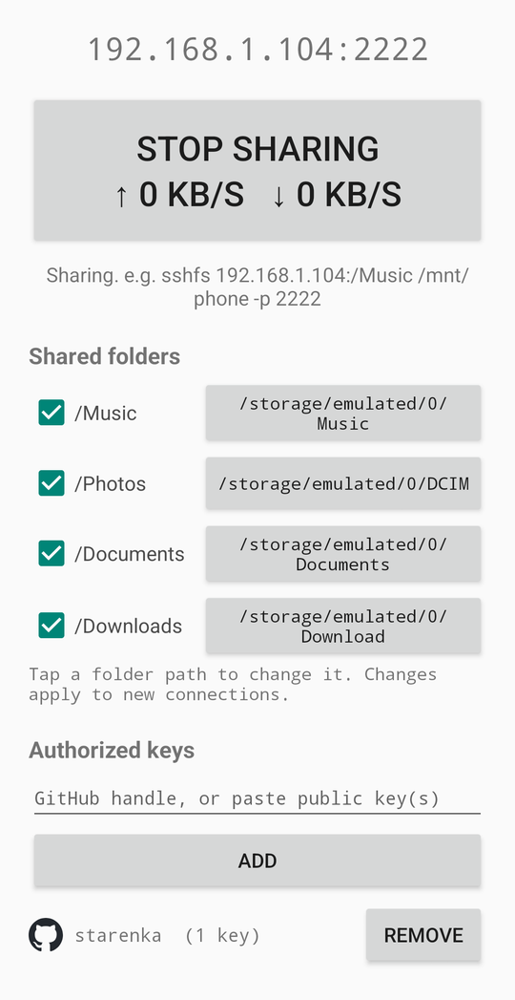

# jiffy

Copy files between your Android phone and your computer over Wi-Fi, with no cable, no cloud and no account.

jiffy is a small Android app that turns your phone into a **key-authenticated SFTP server** for a few folders (Music, Photos, Documents, Downloads). Open the app, tap *Start sharing*, and any SSH/SFTP client on the same network can browse, download and upload: `scp`, `sftp` or an SSHFS mount. Only people whose SSH public key you added can connect; there are no passwords and no shell.

<p align="center"></p>

It is a personal, sideloaded tool (you build and install it yourself; it is not on Google Play) meant for a trusted home network.

## Platforms

- **Phone:** Android 11+.
- **Computer:** anything with an SFTP client. `sftp` and `scp` ship with OpenSSH on Linux, macOS and Windows 10/11. SSHFS mounting works on Linux, on macOS with [macFUSE](https://macfuse.github.io/) + sshfs, and on Windows with [WinFsp](https://winfsp.dev/) + [SSHFS-Win](https://github.com/winfsp/sshfs-win). GUI clients (FileZilla, WinSCP, Cyberduck) work too.
- **The `just` helpers** (`smoke`, `sftp`, `mount`, mDNS discovery via `avahi-browse`) are written for Linux. On other systems use the plain commands below with the phone's IP shown in the app.
- **Building** needs a JDK, the Android SDK and `adb`; Gradle itself runs on any OS, the `Justfile` recipes assume a POSIX shell.

## Features

- Shows the phone's Wi-Fi address and a big *Start / Stop sharing* button, with live ↑/↓ transfer rate while sharing.
- SFTP listens only on the displayed Wi-Fi IPv4 address (IPv6 is not used), on port `2222` (Apache MINA SSHD). If that network or address changes, sharing stops until you start it again. No shell, no exec, no password login.
- Authorized keys are managed in the app: enter a GitHub handle (fetches `https://github.com/HANDLE.keys`) or paste public keys. Imports are snapshots: re-import a handle to replace its keys, including when it now has none. Failed imports leave saved keys unchanged. With no keys configured, nobody can log in.
- Advertises itself as `jiffy-<id>` (`_ssh._tcp`, port 2222; `<id>` = first 6 letters/digits of the host key fingerprint) over mDNS only while sharing, so the Linux side can find it. It reveals just that id, the IP and the port.
- Persistent host key generated on the phone at first start (fingerprint shown in the app), followed by a build line (git revision, `-dirty` if uncommitted, build time) so you can tell which build is installed.
- A read-only virtual root lists only enabled shares: `/Music`, `/Photos` (DCIM), `/Documents`, `/Downloads`. Tap a path to edit it; only saving the resolved folder changes what is shared.
- Runs as a foreground service with wake and Wi-Fi locks. Folder and key changes apply to new connections only. Stop sharing to disconnect existing clients.

## Requirements

- Android 11+ (developed on Android 17, arm64). The app needs *All files access*.
- Build: JDK 17/21 (Gradle 8.13 can't run on JDK 25), Android SDK with build-tools 36.0.0, [`just`](https://github.com/casey/just), `adb`.

## Install

Download the signed APK from the [Releases page](https://github.com/starenka/jiffy/releases) and install it (allow installs from your browser or file manager). Or build it yourself:

## Build and install

Enable *Developer options → Wireless debugging* (or USB debugging) on the phone.

```sh
just pair IP:PAIRPORT      # once, wireless debugging only
just connect IP:PORT
just deploy                # build, install, grant permissions, launch
```

`just` lists all targets (`logs`, `errors`, `stop`, `reset`, `uninstall`, ...).

## Use

1. In the app, add your key (e.g. your GitHub handle) and tap *Start sharing*.
2. From Linux:

```sh
just smoke                       # list + scp round-trip test
just sftp                        # interactive sftp
just mount                       # sshfs of all shares at /tmp/phone (MNT=...)
just mount 192.168.0.50 Music    # a single share from a given IP
just umount

scp -P 2222 file.flac PHONE_IP:/Music/
sshfs -p 2222 PHONE_IP:/Music /mnt/phone
```

`just mount` caches directory listings and attributes for 2 minutes to reduce Wi-Fi round trips, so changes made elsewhere may appear late. Set `SSHFS_OPTS=""` for fresh listings, or your own `-o` list.

While sharing, the app advertises a `jiffy-<id>` `_ssh._tcp` mDNS service on the Wi-Fi network (removed when you stop). `just sftp|smoke|mount` find the phone through it with `avahi-browse` (needs avahi-daemon), so no adb or fixed IP is needed on any network that allows multicast. `PHONE_IP=ip` overrides the lookup and an explicit `ip` argument skips it. If several phones are sharing, the one whose id matches a key in `~/.ssh/known_hosts` is chosen (this only selects; ssh still verifies the host key). If that is still ambiguous it lists them and stops; pick one with `PHONE_ID=<id>` (a prefix is enough).

## Notes

- **rsync is not supported.** rsync over SSH needs to start an `rsync` process on the phone, and jiffy deliberately has no shell/exec. To synchronise, mount with `just mount` and run `rsync -rt --size-only --progress /tmp/phone/Music/ ~/Music/` locally (skips unchanged files, but no delta transfer: changed files are sent whole), or use `rclone sync` with an SFTP remote (`host`, `port 2222`, your key), which also needs no remote helper.
- Throughput depends on the Wi-Fi link; 5 GHz or a nearby AP matters far more than anything in the app.
- Midnight Commander on an sshfs mount may show "Cannot set ext2 attributes". That's the kernel's FUSE layer rejecting an ioctl, not a server problem. Disable *Preserve attributes* in the copy dialog or ignore it.
- Symlinks can't be created on shared storage, so there's no symlink-escape path.
- Intended for personal, sideloaded use on a trusted LAN.

## Layout

```
app/src/main/kotlin/cz/starenka/jiffy/
  SftpService.kt   MINA SSHD server, foreground service
  vfs/VirtualFs.kt virtual filesystem restricted to enabled shares
  Config.kt        shares, ports, keys, settings
  GitHubKeys.kt    GitHub .keys import
  HostKey.kt       persistent host key
  MainActivity.kt  UI
Justfile           build / deploy / test helpers
scripts/phone-ip   finds the phone's IP (PHONE_IP, else mDNS)
```

## Releasing

Releases are built by GitHub Actions when a `v*` tag is pushed (`git tag v1.2.3 && git push origin v1.2.3`): tests run, the APK is signed and attached to a GitHub Release. The version name comes from the tag, the version code is `major*10000 + minor*100 + patch`.

One-time setup: create a keystore (`keytool -genkeypair -keystore jiffy.jks -alias jiffy -keyalg RSA -keysize 4096 -validity 10000`), back it up (losing it means nobody can update in place), and store these repository secrets: `JIFFY_KEYSTORE_BASE64` (`base64 -w0 jiffy.jks`), `JIFFY_KEYSTORE_PASSWORD`, `JIFFY_KEY_ALIAS`, `JIFFY_KEY_PASSWORD`. Local release builds read the same values from `JIFFY_KEYSTORE`, `JIFFY_KEYSTORE_PASSWORD`, `JIFFY_KEY_ALIAS`, `JIFFY_KEY_PASSWORD` environment variables.

## License

[MIT](LICENSE).
